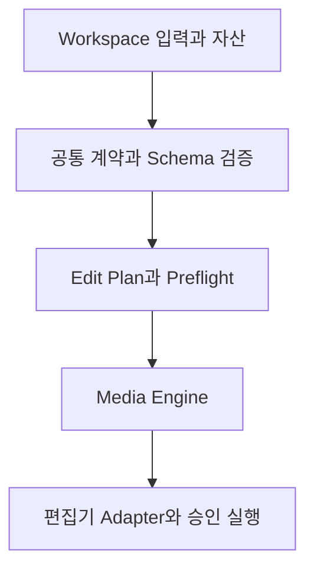

# 아키텍처

## 설계 상태

공통 계약, Python 미디어 엔진, Smart Silence UXP 패널, JavaScript 편집 계획기와 Premiere 공통 안전 모듈이 이전되었습니다. 계약과 계획 검증은 자동 테스트 대상이며, Premiere API 실행 및 cross-platform 미디어 작업은 실제 호스트 검증 전까지 완료로 간주하지 않습니다.



## 경계

| 계층 | 입력과 출력 | 주요 책임 |
| --- | --- | --- |
| Contracts | JSON 문서 ↔ 버전이 지정된 Schema | 프레임 시간, 자산 ID, 실행 상태, Extension과 Agent 전달 형식; 구현 |
| Workspace | Workspace ID + 상대 경로 ↔ 로컬 마운트 | 경로 재연결, Unicode 정규화, 외부 Workspace 확인; 코드 구현·실제 교차 검증 대기 |
| Media Engine | 미디어와 프로젝트 Manifest ↔ Transcript/Timeline/Plan | FFprobe, FFmpeg, 전사, 자막, 체크포인트와 검증; 코드 이전·단위 테스트 |
| Editor Adapter | Edit Plan + Capability ↔ 실행 결과 | Smart Silence UXP 및 Preflight/승인 공통 계약; host adapter/실제 Premiere 검증 대기 |
| Extensions | 선언형 Manifest/Schema/Recipe ↔ 등록된 Action | 공통 Schema 및 기존 planner 이전; 부분 frame adapter 구현, Extension loader 미구현 |

## 공통 시간 규격

- 편집 위치와 길이는 정수 프레임으로 기록합니다.
- 프레임레이트는 `{ numerator, denominator }` 유리수로 기록합니다. `29.97` 같은 소수만으로 타임라인을 계산하지 않습니다.
- Drop-frame 여부는 명시적 boolean이며 표시용 Timecode는 `:`와 `;`를 구분합니다.
- 원본 시간과 타임라인 시간의 변환은 별도 mapping/metadata로 기록합니다. VFR 원본을 단순 CFR로 가정하지 않습니다.

## 실행 안전 흐름

```text
입력 검증 → 자산 해석 → Edit Plan → Preflight → 미리보기 → 사용자 승인 → 복제본에서 실행 → 결과 검증 → 보고서/체크포인트
```

실행 전에 계획을 변경하거나 다시 계산하면 이전 승인은 무효입니다. 충돌 정책은 기본 `block`이며 원본 수정과 자동 삭제는 계약에서 허용하지 않습니다. Premiere 공통 삽입 계약은 Preflight 후 Dry-run 또는 명시적 approval을 요구합니다. 부분 성공, 중단, 실패와 완전 성공은 별도 상태로 기록합니다.

## 저장소와 Workspace

소스와 개발 가상환경은 각 컴퓨터의 내장 저장장치에 둡니다. 영상 원본·프로젝트·산출물은 외장 SSD 또는 사용자가 지정한 Workspace에 둡니다. 공유 저장소에는 개인 영상 데이터를 넣지 않습니다. 자세한 설정은 [크로스플랫폼 개발 안내](CROSS_PLATFORM_DEVELOPMENT.md)와 [외부 Workspace 안내](EXTERNAL_WORKSPACE.md)를 기준으로 합니다.
